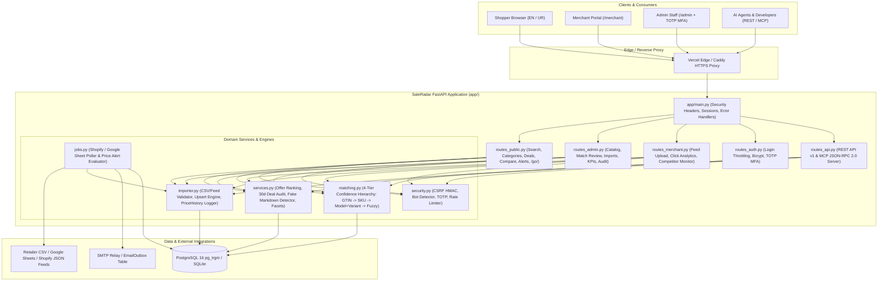

# System Architecture (`ARCHITECTURE.md`)

## 1. High-Level Architectural Overview
SaleRadar uses a **Modular Monolith & Dual-Deployment Architecture** designed in Python 3.12+ and FastAPI. It runs identically on:
1. **Vercel Serverless Functions** (`api/index.py` + `vercel.json`) backed by managed PostgreSQL (Neon / Supabase) or auto-seeded `/tmp/saleradar.db` SQLite for instant zero-config previews.
2. **Self-Hosted Docker Compose Stack** (`docker-compose.yml`) with `web` (Uvicorn), `worker` (background feed & alert scheduler), `db` (PostgreSQL 16 + `pg_trgm`), `caddy` (automatic Let's Encrypt HTTPS), and `backup` (nightly `pg_dump` retention).

---

## 2. Module Responsibilities (`app/`)

| Module | Primary Responsibility |
| :--- | :--- |
| `app/main.py` | FastAPI factory (`create_app`), session middleware, security headers (`X-Frame-Options`, `Cache-Control`, `X-Robots-Tag`), auto-seeding for serverless demos, and HTML/JSON error handlers. |
| `app/config.py` | Environment-driven configuration (`Settings`), Postgres URL normalization (`postgres://` -> `postgresql+psycopg://`), Vercel `/tmp` fallback, and category-specific freshness thresholds. |
| `app/db.py` | SQLAlchemy 2.0 engine & session management, SQLite foreign-key pragma enforcement, PostgreSQL `pg_trgm` GIN index creation, and zero-downtime column auto-migration (`_add_missing_columns`). |
| `app/models.py` | 16 declarative SQLAlchemy 2.0 ORM models using `Numeric(12, 2)` for currency and timezone-aware `UTCDateTime`. |
| `app/services.py` | Read-side domain logic: freshness calculation, organic delivered-price ranking, 90-day daily lowest-price time series, 30-day Deal Truth Score, Fake Markdown Audit (`offer_deal_audit`), Live Deals Radar (`top_price_drops`), and multi-select search/facets. |
| `app/matching.py` | 4-tier deterministic + fuzzy product matching hierarchy, canonical title cleaner, and variant key generator. |
| `app/importer.py` | Per-row CSV/feed validation, domain allow-list checking, nested savepoint upserts, `PriceHistory` append-only logging, and downloadable reject reports. |
| `app/filters.py` | 13 category presets across 4 groups (`Electronics`, `Home Appliances`, `Fashion`, `Beauty`) and natural size/numeric sorting (`XS..4XL`, `UK 4..11`). |
| `app/text.py` | Unicode NFKD normalization, Roman Urdu synonym groups, and alphanumeric model-number compaction. |
| `app/security.py` | Bcrypt password hashing, PyOTP RFC 6238 TOTP generation/verification, per-session CSRF token validation, sliding-window login throttling, and bot User-Agent detection. |
| `app/jobs.py` | Exponential-backoff HTTP feed fetcher, permissioned Shopify `/products.json` paginator, scheduled feed runner, and price-drop alert notifier. |
| `app/routes_api.py` | REST API v1 (`/api/v1/*`) and Model Context Protocol JSON-RPC 2.0 Server (`/api/mcp`). |

---

## 3. Key Architectural Decisions (ADRs)

### ADR-01: Server-Rendered Jinja2 + FastAPI vs. Separate SPA Frontend
- **Context:** Price comparison platforms rely heavily on Google SEO indexing, fast First Contentful Paint (FCP) on budget Android devices in Pakistan, and simple operational maintenance.
- **Decision:** Use FastAPI with Jinja2 server-rendered templates, JSON-LD structured data (`schema.org/Product` & `AggregateOffer`), and server-rendered SVG charts, while exposing `/api/v1/*` and `/api/mcp` from the same ASGI process.
- **Consequence:** Zero JS build step, instant SEO indexability, 100% shared domain logic between web pages and API/MCP consumers.

### ADR-02: Append-Only `PriceHistory` & Observed Median Deal Auditing
- **Context:** Pakistani retailers frequently change both `price` and crossed-out `original_price` during sale events.
- **Decision:** Never overwrite historical prices; append a `PriceHistory` row whenever `price`, `shipping_cost`, or `stock_status` changes, and compute deal labels strictly against the 30-day observed median.
- **Consequence:** Re-importing an unchanged feed is idempotent (zero duplicate history rows), while every genuine price movement is auditable.

### ADR-03: Human-in-the-Loop Fuzzy Matching (`AUTO_FUZZY_NEVER = True`)
- **Context:** Merging a `128GB` phone with a `256GB` phone or a `Non-PTA` phone with a `PTA Approved` phone destroys user trust.
- **Decision:** Only deterministic matches (GTIN, existing Retailer SKU, or exact Brand + Model Number + Variant Key) auto-link. Fuzzy title matches (`score >= 70`) create `MatchCandidate` rows and place the offer in `match_status = "review"`.
