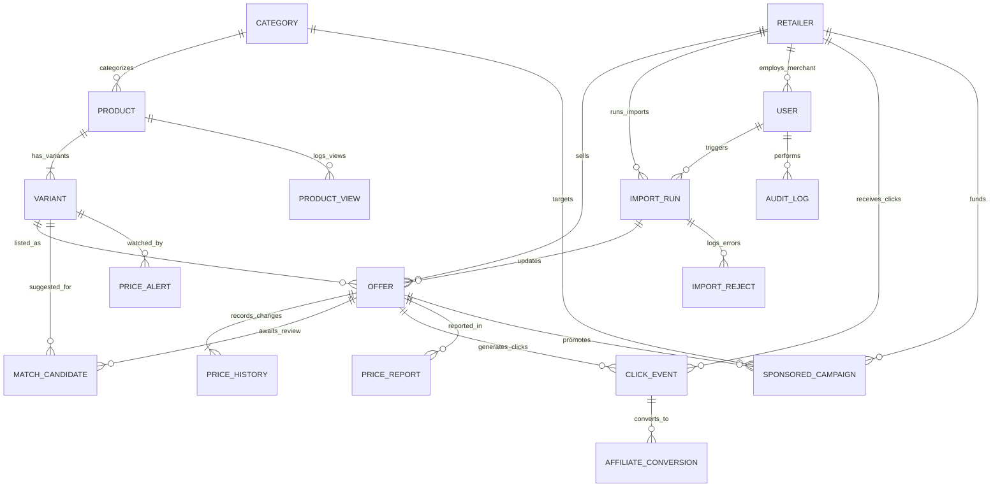

# Database Schema & Data Dictionary (`DATABASE.md`)

## 1. Storage Engine & Precision Standards
- **Primary RDBMS:** PostgreSQL 16+ (with `pg_trgm` extension for trigram similarity search on `products.search_text`).
- **Local / Serverless Fallback:** SQLite 3 with `PRAGMA foreign_keys=ON` enabled on every connection.
- **Monetary Precision:** All prices, shipping costs, target alert prices, and affiliate commissions use `NUMERIC(12, 2)` (`Decimal` in Python) — floating-point numbers are never used for money.
- **Timestamps:** Custom `UTCDateTime` SQLAlchemy type decorator ensures all timestamps are stored and returned as timezone-aware UTC `datetime` objects across both PostgreSQL and SQLite.

---

## 2. Entity-Relationship Diagram (ERD)

---

## 3. Complete Table Specifications (16 Tables)

### 3.1 `categories`
| Column | Type | Constraints | Description |
| :--- | :--- | :--- | :--- |
| `id` | `INTEGER` | `PK` | Auto-increment category ID |
| `name` | `VARCHAR(120)` | `NOT NULL` | Display name (e.g., `Mobile Phones`, `Women's Clothing`) |
| `slug` | `VARCHAR(120)` | `UNIQUE, NOT NULL` | URL-safe slug (`mobile-phones`, `shoes`) |
| `group` | `VARCHAR(60)` | `DEFAULT 'Other'` | Top-level group (`Electronics`, `Home Appliances`, `Fashion`, `Beauty`) |
| `filter_specs` | `JSON` | `DEFAULT '[]'` | Ordered list of facet keys enabled for this category |

### 3.2 `products`
| Column | Type | Constraints | Description |
| :--- | :--- | :--- | :--- |
| `id` | `INTEGER` | `PK` | Canonical product ID |
| `title` | `VARCHAR(300)` | `NOT NULL` | Canonical variant-stripped title (e.g., `Samsung Galaxy A55 5G`) |
| `slug` | `VARCHAR(320)` | `UNIQUE, INDEX` | SEO product URL slug |
| `brand` | `VARCHAR(120)` | `INDEX, NOT NULL` | Manufacturer or fashion label (`Samsung`, `Apple`, `Rang`) |
| `model_number` | `VARCHAR(120)` | `INDEX, NULL` | Manufacturer part / model code (`SM-A556E`, `MTP03`) |
| `category_id` | `INTEGER` | `FK -> categories.id` | Associated category |
| `specs` | `JSON` | `DEFAULT '{}'` | Normalized technical/fashion key-value specifications |
| `image_url` | `VARCHAR(1000)` | `NULL` | Canonical product image URL |
| `description` | `TEXT` | `NULL` | Editorial summary |
| `search_text` | `TEXT` | `GIN INDEX (pg_trgm)` | Pre-normalized search document (brand + title + model + specs + variants) |
| `created_at` | `TIMESTAMPTZ` | `NOT NULL` | Creation UTC timestamp |

### 3.3 `variants`
| Column | Type | Constraints | Description |
| :--- | :--- | :--- | :--- |
| `id` | `INTEGER` | `PK` | Variant ID |
| `product_id` | `INTEGER` | `FK -> products.id CASCADE` | Parent canonical product |
| `storage` | `VARCHAR(40)` | `NULL` | Storage capacity (`128GB`, `256GB`, `512GB`) |
| `ram` | `VARCHAR(40)` | `NULL` | Memory (`8GB`, `16GB`) |
| `colour` | `VARCHAR(60)` | `NULL` | Colorway (`Awesome Navy`, `Black`) |
| `size` | `VARCHAR(40)` | `NULL` | Clothing or shoe size (`S`, `M`, `L`, `UK 8`, `32`) |
| `region` | `VARCHAR(60)` | `NULL` | Telecom/region status (`PTA Approved`, `Non-PTA (JV)`) |
| `gtin` | `VARCHAR(20)` | `UNIQUE, NULL` | 8/12/13/14-digit EAN/UPC barcode |
| `variant_key` | `VARCHAR(200)` | `UNIQUE(product_id, variant_key)` | Normalized composite key (`256gb|8gb|black||ptaapproved`) |

### 3.4 `retailers`
| Column | Type | Constraints | Description |
| :--- | :--- | :--- | :--- |
| `id` | `INTEGER` | `PK` | Retailer ID |
| `name` | `VARCHAR(160)` | `NOT NULL` | Store display name |
| `slug` | `VARCHAR(180)` | `UNIQUE, NOT NULL` | Store profile slug |
| `domain` | `VARCHAR(200)` | `NOT NULL` | Allow-listed root domain for outbound redirects (`alpha.pk`) |
| `city` | `VARCHAR(120)` | `NULL` | Primary operations city (`Karachi`, `Lahore`, `Islamabad`) |
| `delivery_regions` | `VARCHAR(300)` | `NULL` | Delivery coverage (`Nationwide`, `Punjab`) |
| `status` | `VARCHAR(20)` | `DEFAULT 'pending'` | `prospect` (hidden) \| `pending` \| `active` \| `suspended` |
| `verified` | `BOOLEAN` | `DEFAULT FALSE` | True only when business verification evidence is recorded |
| `verification_notes` | `TEXT` | `NULL` | Admin audit evidence for store verification |
| `feed_method` | `VARCHAR(20)` | `DEFAULT 'csv'` | `csv` \| `feed_url` \| `manual` \| `shopify` |
| `feed_url` | `VARCHAR(1000)` | `NULL` | HTTPS CSV or Shopify base URL |
| `permission_reference` | `VARCHAR(300)` | `NULL` | Written agreement / email reference authorizing ingestion |
| `affiliate_status` | `VARCHAR(30)` | `DEFAULT 'none'` | `none` \| `approved` |
| `affiliate_param` | `VARCHAR(200)` | `NULL` | Query parameter appended on `/go/{id}` (e.g., `ref=saleradar`) |
| `plan` | `VARCHAR(20)` | `DEFAULT 'free'` | `free` (500 offers) \| `pro` (unlimited + feed sync + competitors) |

### 3.5 `offers`
| Column | Type | Constraints | Description |
| :--- | :--- | :--- | :--- |
| `id` | `INTEGER` | `PK` | Offer ID |
| `retailer_id` | `INTEGER` | `FK -> retailers.id CASCADE` | Selling store (`UNIQUE(retailer_id, retailer_sku)`) |
| `variant_id` | `INTEGER` | `FK -> variants.id SET NULL` | Linked canonical variant (`NULL` if in review/unmatched) |
| `retailer_sku` | `VARCHAR(200)` | `NOT NULL` | Store's internal SKU or product URL |
| `retailer_title` | `VARCHAR(400)` | `NOT NULL` | Original store title kept for audit |
| `product_url` | `VARCHAR(1000)` | `NOT NULL` | Direct product page URL on `retailer.domain` |
| `price` | `NUMERIC(12,2)` | `NOT NULL` | Current selling price |
| `original_price` | `NUMERIC(12,2)` | `NULL` | Store's claimed crossed-out `'Was'` price (audited against 30d history) |
| `promo_code` | `VARCHAR(80)` | `NULL` | Active voucher/coupon code (`BLESSED10`, `EIDSALE`) |
| `currency` | `VARCHAR(3)` | `DEFAULT 'PKR'` | ISO currency code (`PKR`, `USD`, `AED`, `GBP`, `EUR`, `INR`) |
| `shipping_cost` | `NUMERIC(12,2)` | `NULL` | `NULL` = unknown shipping, `0.00` = free delivery |
| `stock_status` | `VARCHAR(20)` | `DEFAULT 'in_stock'` | `in_stock` \| `limited` \| `preorder` \| `out_of_stock` |
| `condition` | `VARCHAR(20)` | `DEFAULT 'new'` | `new` \| `refurbished` \| `used` \| `open_box` |
| `checked_at` | `TIMESTAMPTZ` | `NOT NULL` | Last verified timestamp (drives Fresh / Stale / Hidden rules) |
| `match_status` | `VARCHAR(20)` | `DEFAULT 'matched'` | `matched` \| `review` \| `unmatched` |
| `match_method` | `VARCHAR(40)` | `NULL` | `gtin` \| `sku_mapping` \| `brand_model_variant` \| `fuzzy` \| `manual` |
| `match_confidence` | `FLOAT` | `NULL` | Confidence score (`0.0` to `1.0`) |

### 3.6 Operations, Analytics & Governance Tables
- **`price_history`**: `(id, offer_id, price, shipping_cost, stock_status, captured_at)` — immutable time-series log.
- **`import_runs`** & **`import_rejects`**: Tracks every CSV/feed execution with row counts (`rows_total`, `rows_ok`, `rows_review`, `rows_rejected`) and per-row failure reasons.
- **`match_candidates`**: Stores top-5 fuzzy variant suggestions (`score`, `evidence`, `status`) for human review.
- **`users`**: Staff (`admin`, `editor`) and store (`merchant`) accounts with `password_hash`, `totp_secret`, and `retailer_id`.
- **`click_events`**, **`search_logs`**, **`product_views`**, **`affiliate_conversions`**: First-party anonymous telemetry (`session_id`, `is_bot`, `from_search`, `commission`).
- **`sponsored_campaigns`**, **`price_alerts`**, **`price_reports`**, **`contact_messages`**, **`email_outbox`**, **`audit_logs`**: Platform operations, double opt-in alert tokens, and immutable staff action audit trail.
