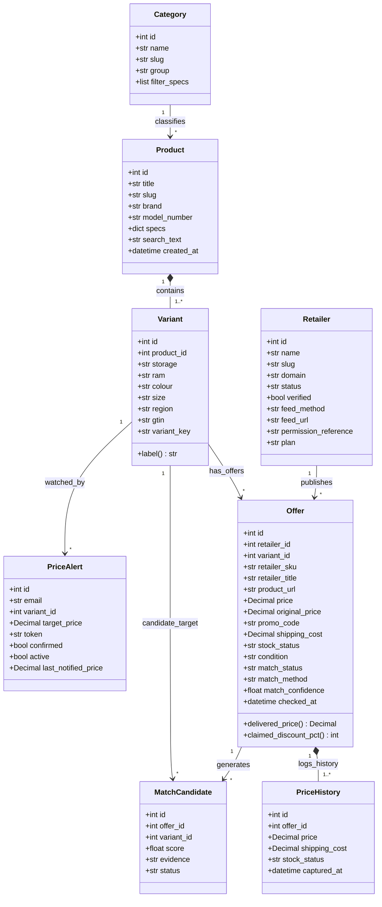
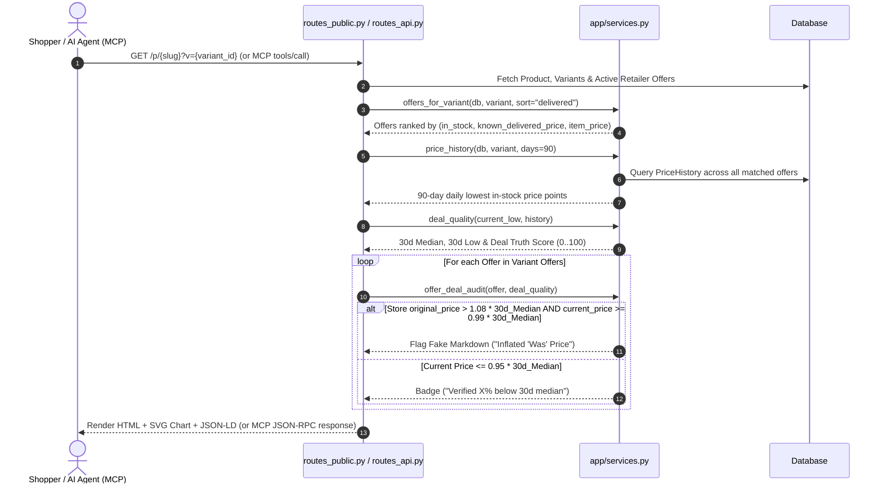
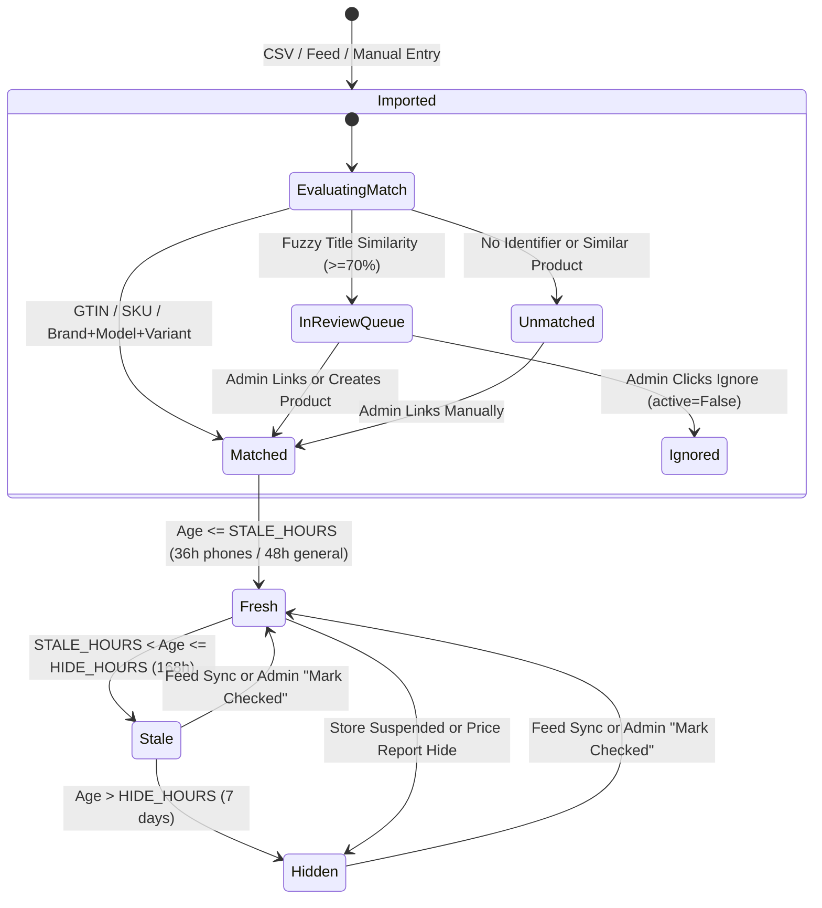

# UML Diagrams (`UML_DIAGRAMS.md`)

This document provides complete **Unified Modeling Language (UML)** diagrams for SaleRadar v2.0 across five views: **Class Diagram**, **Ingestion & 4-Tier Matching Sequence Diagram**, **Fake Markdown & Deal Truth Sequence Diagram**, **Offer Lifecycle State Machine**, and **Use-Case / Component Diagram**.

---

## 1. UML Domain Class Diagram



---

## 2. UML Sequence Diagram — Feed Ingestion & 4-Tier Matching Engine

```mermaid
sequenceDiagram
    autonumber
    actor Actor as Merchant / Admin / Scheduler
    participant Importer as app/importer.py
    participant Validator as validate()
    participant Matcher as app/matching.py
    participant DB as PostgreSQL / SQLite

    Actor->>Importer: Upload CSV or Trigger Feed Sync
    Importer->>DB: Create ImportRun (status="running")
    loop For each row in CSV/Feed
        Importer->>Validator: clean_row(raw) & validate(row, retailer)
        alt Validation Fails (Bad URL, Negative Price, Unknown Domain)
            Validator-->>Importer: Return error reasons
            Importer->>DB: Insert ImportReject (row_number, reasons)
        else Validation Succeeds
            Validator-->>Importer: Clean normalized row
            Importer->>Matcher: match_row(db, row, retailer_id, allow_create)
            alt Tier 1: Exact GTIN Barcode Match
                Matcher-->>Importer: MatchResult(status="matched", method="gtin", conf=1.0)
            else Tier 2: Existing Retailer SKU Mapping
                Matcher-->>Importer: MatchResult(status="matched", method="sku_mapping", conf=0.98)
            else Tier 3: Exact Brand + Model Number + Variant Key
                Matcher-->>Importer: MatchResult(status="matched", method="brand_model_variant", conf=0.95)
            else Tier 4: Fuzzy Title Similarity >= 70%
                Matcher-->>Importer: MatchResult(status="review", method="fuzzy", candidates=[...])
            end
            Importer->>DB: Upsert Offer within SAVEPOINT
            alt Price, Shipping, or Stock Changed
                Importer->>DB: Append immutable PriceHistory record
            end
            opt Match Status == "review"
                Importer->>DB: Insert top-5 MatchCandidate records for human review
            end
        end
    end
    Importer->>DB: Update ImportRun (status="done", finished_at=now())
```

---

## 3. UML Sequence Diagram — Shopper Search, Deal Truth & Fake Markdown Audit



---

## 4. UML State Machine Diagram — Offer Lifecycle & Freshness Governance


